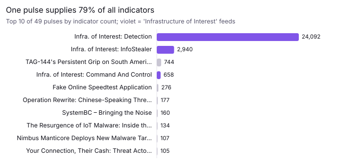
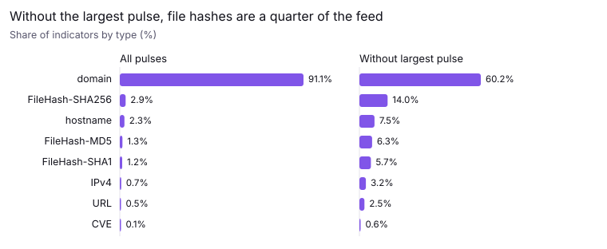
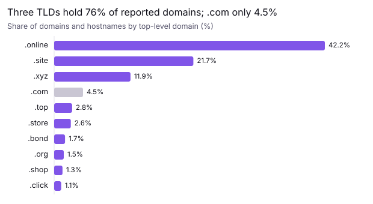

# What does an OTX subscription feed actually contain?

> **DRAFT: pending author review.** All numbers are computed in [`notebooks/analysis.ipynb`](notebooks/analysis.ipynb) from the included snapshot. The interpretation is open to revision before publication.

**Dataset:** 30,343 indicators from 49 OTX pulses, collected on 2025-09-25 with this project's collector (`data/raw_iocs.csv`).

## Key findings

1. **The feed is dominated by a single pulse.** "Infrastructure of Interest: Medium Confidence Detection" supplies 24,092 indicators (79.4%). The four "Infrastructure of Interest" pulses together supply 91.5%. The median pulse contains just 25 indicators.

   

2. **That concentration distorts simple summaries.** Counted naively, 91.1% of indicators are domains. Excluding the largest pulse, domains fall to 60.2% and file hashes (SHA-256, MD5, SHA-1) rise to about 26% of the remaining 6,251 indicators. Any chart of this feed should be read with the pulse mix in mind.

   

3. **Reported domains cluster in a few newer top-level domains.** `.online` (42.2%), `.site` (21.7%) and `.xyz` (11.9%) account for 76% of the 28,323 domains and hostnames. `.com` accounts for only 4.5%. The pattern holds outside the largest pulse too (`.online` 22.2%, `.store` 15.3%, `.site` 11.8%, `.com` 6.6%), so it is not just one source's quirk.

   

4. **The data is clean in format but has some repetition.** No missing values. Every MD5, SHA-1, SHA-256 and IPv4 value matches its expected format. 56 indicator values appear twice: 53 are repeated inside the same pulse, and 3 are reported by two different pulses. The collector now removes the within-pulse duplicates.

5. **Most referenced CVEs are recent, but not all.** 25 of the 36 CVEs date from 2024 to 2025. 3 date from 2013: older vulnerabilities still appear in current threat reports.

## What this means in practice

- Weight or group by pulse before drawing conclusions from raw counts; otherwise one source sets the picture.
- TLD is a cheap, useful signal for triage, but `.online`/`.site`/`.xyz` also host legitimate sites. It should raise priority, not trigger a block on its own.

## Limitations

- One snapshot on one day, from one account's subscriptions. It is not a measure of the global threat landscape.
- The snapshot predates the metadata columns, so pulse authors, tags and creation dates cannot be analysed yet. Data collected from now on includes them.
- Indicators are taken as reported; whether each is still malicious is not verified.
